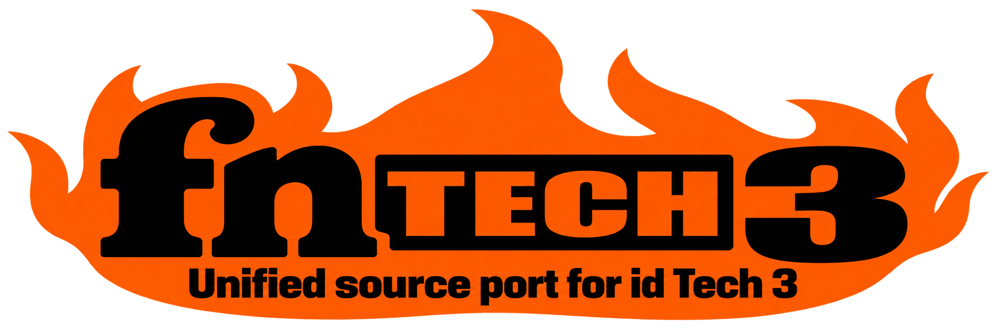
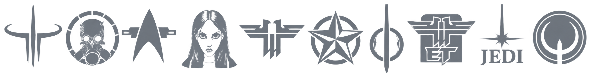

<div align="center">

<h1>
  
</h1>

<p>
  
</p>

### One engine for Quake III Arena, Quake Live, RTCW, Enemy Territory, Elite Force, Jedi Knight, Alice, F.A.K.K.2, and Medal of Honor

<p>
  <a href="docs/fntech3/COMPATIBILITY.md"></a>
  <a href="#3-getting-started"></a>
  <a href="#4-documentation"></a>
  <a href="BUILD.md"></a>
  <a href="LICENSE"></a>
</p>

*Plays: Quake III Arena, Quake Live, Return to Castle Wolfenstein (SP/MP), Wolfenstein: Enemy Territory, Star Trek Voyager: Elite Force (SP/Holomatch), Star Wars Jedi Knight: Jedi Academy (SP/MP), Star Wars Jedi Knight II: Jedi Outcast (SP/MP), American McGee's Alice, Heavy Metal: F.A.K.K.2, and Medal of Honor: Allied Assault · Base version: `0.1.0` · Current build: `0.1.0`*

</div>

> [!IMPORTANT]
> **Start with a clean game folder.** We recommend running
> fnTech3 without other asset packages, or custom game code
> (QVMs), in the game's base folder, such as Quake III Arena's `baseq3`. They
> can replace files fnTech3 relies on and clash with its
> features. For example, the baseq3a package brings its own QVMs for Quake III
> Arena, which may interfere with fnTech3's widescreen
> correction. To keep using packages like these, turn the corrections off:
> `r_fovCorrection 0` for the view, `cl_hudAspect 0` for the HUD and
> `cl_menuAspect 0` for menus. The
> [Widescreen Guide](docs/ASPECT_CORRECTION.md#the-four-settings) explains
> each setting.

## 1. Introduction

**fnTech3** is a free, modern engine for the classic games of
the Quake III era. You keep your own copy of the game; fnTech3
takes the place of the program that runs it, with sharper graphics, 3D sound,
widescreen support and many small comforts -- and each game still plays the
way it always did, online and off. One download -- one program, one dedicated
server and three renderers -- aims to run ten games:

- **Quake III Arena**, from its 1999 test versions to 1.32 and ioquake3,
  including playing online with the original 1.29 to 1.32 releases and
  watching demos back to 1.11;
- **Quake Live**;
- **Return to Castle Wolfenstein**, single player and multiplayer;
- **Wolfenstein: Enemy Territory**;
- **Star Trek Voyager: Elite Force**, single player and Holomatch;
- **Star Wars Jedi Knight: Jedi Academy**, single player and multiplayer;
- **Star Wars Jedi Knight II: Jedi Outcast**, single player and multiplayer;
- **American McGee's Alice** and **Heavy Metal: F.A.K.K.2**, which run Ritual
  Entertainment's engine rather than a Quake III one;
- **Medal of Honor: Allied Assault**, whose engine 2015 built from Ritual's
  and Quake III's.

### Games and status

| Game | Name to start it | Status |
| --- | --- | --- |
| Quake III Arena | `quake3` (`q3`) | **Playable** in the normal download, on Windows and Linux. Plays online with 1.32, ioquake3 and the original 1.29 to 1.31 releases, and plays demos back to 1.11 ([versions](docs/GAMES.md#quake-iii-arena-quake3)). |
| Quake Live | `quakelive` (`ql`) | **Playable** in the normal download. The client needs Windows, where Quake Live's own game code runs. |
| Return to Castle Wolfenstein | `rtcw-sp`, `rtcw-mp` | Experimental: development builds with `-Drtcw-development=true`. |
| Wolfenstein: Enemy Territory | `wolfet` (`et`) | Experimental: `-Dwolfet-development=true`. |
| Star Trek Voyager: Elite Force | `stvef-sp`, `stvef-mp` | Experimental: `-Dstvef-development=true`; single player on Windows only. |
| Star Wars Jedi Knight: Jedi Academy | `jka-sp`, `jka-mp` | Experimental and early: `-Djka-development=true`. A multiplayer server runs, and the client joins original servers with parts of the game drawn; the campaign and full graphics are still to come. |
| Star Wars Jedi Knight II: Jedi Outcast | `jk2-sp`, `jk2-mp` | Experimental and early: `-Djk2-development=true`. A multiplayer server runs; there is no working client yet. |
| American McGee's Alice | `alice` | Experimental, Windows: `-Dalice-development=true`. |
| Heavy Metal: F.A.K.K.2 | `fakk2` | Experimental, Windows: `-Dfakk2-development=true`. |
| Medal of Honor: Allied Assault | `mohaa` | Experimental, Windows: `-Dmohaa-development=true`. |
| Quake III Arena IHV Test | `q3-ihv` | Experimental, Windows, dedicated server only: `-Dq3-ihv-development=true`. |
| Quake III Arena Q3Test 1.02 to 1.08 | `q3test` | Experimental, Windows: `-Dq3test-development=true`. |

**No game is finished yet.** The [Games Guide](docs/GAMES.md) says plainly
what works in each one, and the
[compatibility ledger](docs/fntech3/COMPATIBILITY.md) records every test
behind it. A successful build, or a feature inherited from FnQL, does not
count as a game working.

fnTech3 contains no game files. Use your own installed copy of
the game; its files stay where they are. Release downloads leave out the
optional Steam add-on and Valve's Steam files, so Steam features need a
separately supplied add-on, and say they are unavailable rather than
pretending to work.

fnTech3 grew from two engines: FnQuake3's modernised Quake III
and FnQL's Quake Live work, both descended from Quake3e, ioquake3 and id
Software's source release.

## 2. Features

What fnTech3 adds to the games it plays. Each guide says which
games a feature works in, and every feature is still being checked game by
game against the compatibility ledger. Quake Live's own menus, Steam and
Workshop features belong to Quake Live alone.

- **Unified game compatibility** -- one engine for many games. It starts one
  game at a time and follows that game's own rules -- its game code, online
  play, demos and saved games -- so every game plays like itself. Games with
  separate single-player and multiplayer modes switch by restarting.
- **A launcher that finds your games** -- it looks in Steam, GOG, Heroic,
  Lutris, disc installs and the usual game folders, lists every installation
  with its icon, store and folder, and starts the one you click, in the mode
  and with the mod you choose.
- **Fast, modern hardware rendering** -- three renderers in every game,
  **GLx**, **Vulkan** and **RTX**, built to make the most of today's graphics
  cards. RTX ray traces each map with light from its own lamps, sky and sun.
- **Modern visual upgrades** -- optional HDR, smoother edges, sharper
  textures, glow, smooth lights with real shadows, lights for each map's own
  lamps, motion blur, lens flares, softer smoke, livelier water, an underwater
  view and atmospheric fog.
- **Improved player visibility** -- an optional glow and outline on other
  players in Quake III Arena and Quake Live, in team or enemy colours of your
  choice, and a cartoon cel-shaded look for every game.
- **Better modern hardware and OS support** -- high resolutions and refresh
  rates, borderless windows, instant Alt+Enter, controllers you can plug in
  at any time, and each game's own icon, remade in high resolution.
- **Low-latency, configurable controls** -- raw mouse input, Quake Live's
  exact mouse sensitivity and acceleration, the classic mouse styles,
  gamepads, and typing in any language; each game's menus see the keys its
  original showed them.
- **Modern spatial audio** -- 3D sound with headphone surround, surround
  speakers, room echo, sounds muffled by walls, and sound zones for the maps
  of Quake III Arena, Quake Live, RTCW, Enemy Territory, Alice, F.A.K.K.2 and
  Medal of Honor, with each game's own sound ranges -- and the original sound
  mixer still there if you want it.
- **Major quality-of-life improvements** -- a console that scales, scrolls
  smoothly, suggests commands and copies and pastes; widescreen view and HUD
  for every game made for 4:3 screens; silence when you switch away; and less
  work for your computer in the background.
- **In-game entity editor** -- move, add, copy, delete and change a map's
  objects in the game, with undo, and save them as a `maps/<map>.ent` file
  that the server loads in place of the map's own, in every game.
- **Better screenshots, video and streaming tools** -- PNG, JPEG, TGA and BMP
  screenshots, copying to the clipboard, your own file names, camera notes,
  map previews, watermarks, cube maps, any resolution, and video recording
  through FFmpeg.
- **Faster content handling** -- quicker starts and map changes with big
  collections of mods and maps, higher limits, fast downloads and, in Quake
  Live, the Workshop items a server needs, fetched for you.
- **Greater stability and security** -- many fixes from Quake3e and
  FnQuake3, careful checking of every game file, demo and network message,
  less memory, better protection online, and graceful fallbacks when an
  optional feature is missing.

## 3. Getting Started

Download a release from the
[Releases page](https://github.com/themuffinator/fnTech3/releases) -- the
`windows-msvc-x86` zip for Windows, or the `linux-x86` archive -- and unpack
it into a folder of its own, or build it yourself with the
[Build Guide](BUILD.md). Releases play Quake III Arena and Quake Live; the
other games need a development build with their option turned on. The
[Getting Started guide](docs/GETTING_STARTED.md) walks through everything,
and every release includes the player guides as web pages in its `manual`
folder.

Keep everything from the download together: `fntech3-pkg.fnz`,
`fnql-web.pak`, the `fnql_<renderer>_x86` renderers and the libraries stay
beside `fntech3.exe` and `fntech3.ded.exe`.
Upgrade the program and `fntech3-pkg.fnz` together.

### Starting a game

The simplest way is the launcher: run `fntech3-launcher.exe`. It
finds your games in Steam, GOG and the usual game folders, lists each with its
icon, where it came from and its folder, and starts the one you click; the
[Launcher Guide](docs/LAUNCHER.md) explains it.

Without the launcher: if exactly one supported game is installed through
Steam, just run `fntech3.exe`. Otherwise name the game and its
folder -- and,
to keep its settings apart from the original game's, a home folder of its
own. These examples start in a window:

```powershell
.\fntech3.exe +set com_gameProfile quake3 +set fs_basepath "<Quake III Arena folder>" +set fs_homepath "<Q3 home>" +set r_fullscreen 0
.\fntech3.exe +set com_gameProfile quakelive +set fs_basepath "<Quake Live folder>" +set fs_homepath "<QL home>" +set r_fullscreen 0
```

A development build starts the experimental games the same way:

```powershell
.\fntech3.exe +set com_gameProfile rtcw-sp +set fs_basepath "<Return to Castle Wolfenstein folder>" +set fs_homepath "<RTCW SP home>" +set r_fullscreen 0
.\fntech3.exe +set com_gameProfile alice +set fs_basepath "<Alice folder>" +set fs_homepath "<Alice home>" +set r_fullscreen 0
```

Games with single-player and multiplayer modes -- Return to Castle
Wolfenstein, Elite Force, Jedi Academy and Jedi Outcast -- always need the
mode named. `gameList` in the console lists every game and whether this build
can start it. The [Games Guide](docs/GAMES.md) covers finding games, home
folders and each game in detail.

### Dedicated servers

The dedicated server is `fntech3.ded`. Name the game and give
it a home folder, for example on Linux:

```sh
./fntech3.ded +set com_gameProfile quakelive +set fs_basepath "<Quake Live folder>" +set fs_homepath "<QL server home>" +set dedicated 2 +map campgrounds
```

### Platforms

The shared client is built and tested for Windows x86, because the game code
of Quake Live and of every experimental game with a client exists only as
32-bit Windows libraries. The Linux i686 build is the dedicated-server target;
Quake Live's Linux server runs its own `qagamei386.so`, while the Linux client
cannot load Quake Live's Windows-only client and menus. Other platforms and
architectures are unsupported, and the Quake III-only x64 RTX diagnostic build
does not count towards the shared client.

## 4. Documentation

The [documentation index](docs/README.md) lists everything. The main entries:

### Player guides

- [Getting Started](docs/GETTING_STARTED.md) for installing, starting your
  first game, the console and settings files.
- [Launcher Guide](docs/LAUNCHER.md) for the window that finds your games and
  starts them.
- [Games Guide](docs/GAMES.md) for every game, what you need, playing online
  and what works today.
- [Graphics Guide](docs/DISPLAY.md) for window and fullscreen, smoother
  edges, HDR, lighting, shadows, water, fog and glow.
- [Widescreen Guide](docs/ASPECT_CORRECTION.md) for field of view, the HUD,
  menus and movies on wide screens.
- [Player Highlights Guide](docs/VISUALS.md) for making other players stand
  out.
- [Sound Guide](docs/AUDIO.md) for headphones, surround, 3D sound, devices and
  fixing sound problems.
- [Console Guide](docs/CONSOLE.md) for commands, suggestions, copy and paste,
  and the console's look.
- [Screenshot Guide](docs/SCREENSHOTS.md) for formats, file names,
  watermarks, map previews and cube maps.
- [GLx Renderer Guide](docs/GLX.md) for the default renderer and fixing
  picture problems.
- [RTX Renderer Guide](docs/RTX.md) for ray tracing: what you need, turning it
  on and tuning it.
- [Entity Editor Guide](docs/ENTITY_EDITOR.md) for editing a map's entities
  in the game and the `.ent` overrides the server loads.

Release packages include these guides as web pages in their `manual` folder,
built from the same files by
[`scripts/player_manual.py`](scripts/player_manual.py).

### Technical and build docs

- [Build Guide](BUILD.md) for compiling fnTech3 and enabling
  each game's development option.
- [Architecture overview](docs/fntech3/ARCHITECTURE.md) for how profiles,
  adapters and the shared subsystems fit together.
- [Compatibility ledger](docs/fntech3/COMPATIBILITY.md) for the unified goal,
  all sixteen profiles, observed evidence, open gates and release sign-off.
- [Engine package](docs/fntech3/PACKAGES.md) for `fntech3-pkg.fnz` and its
  per-game sidecars.
- [Changelog](CHANGELOG.md) for fnTech3's reviewed release
  history, starting at 0.1.0, and [releasing](docs/fntech3/RELEASING.md) for
  preparing a version.
- [Project mission and contributor rules](AGENTS.md) for the shared-engine
  invariants and non-regression requirements.
- [RTX Renderer Contract](docs/fnql/RTX_RENDERER.md) for the renderer's module
  boundary, conservative defaults, build gates and runtime validation.
- [FnQL baseline documents](docs/fnql/README.md) for the Quake Live profile's
  engine contracts -- [WebUI](docs/fnql/WEBUI_BACKEND.md),
  [Steam provider](docs/fnql/STEAM_PROVIDER.md),
  [input](docs/fnql/INPUT_COMPATIBILITY.md) and more -- and the inherited
  renderer and audio design notes.
- [FnQL baseline release history](https://github.com/themuffinator/FnQL/releases)
  for historical downloads and changelogs; these are not fnTech3
  releases.

## 5. Credits

fnTech3 combines [FnQuake3](https://github.com/themuffinator/FnQ3) and
[FnQL](https://github.com/themuffinator/FnQL), with the id Software, ioquake3
and Quake3e engine lineage. QLSRP, OpenJK, OpenAlice, iortcw, Lilium Voyager
and other projects supply behavioral and format evidence for independently
written implementation work; each use is recorded in the credits.

See [CREDITS.md](CREDITS.md) for pinned source lineage, acknowledgements and
trademark notices, and [THIRD_PARTY_NOTICES.md](THIRD_PARTY_NOTICES.md) for
incorporated external implementation data and its license.
