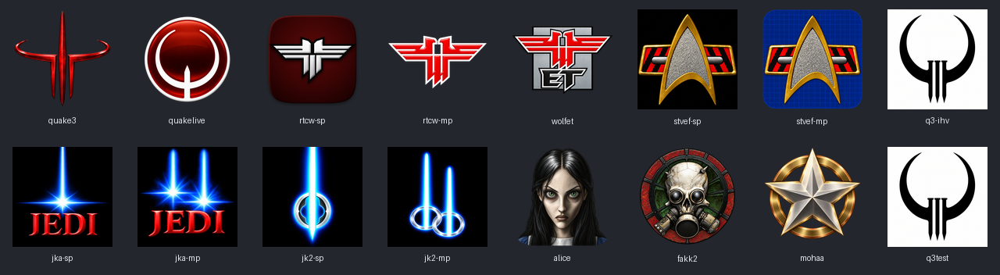

# Game icons

Imagegen remakes of thirteen original application icons, plus the existing
RTCW single-player icon as a temporary fallback. Imagegen rejected that
variant at its output safety check on three attempts, including the requested
retry; its replacement remains outstanding. There is one icon per game profile,
plus a standalone imagegen remake of Medal of Honor: Allied Assault.
The running client shows the active game's remake as its
window, taskbar and Dock icon on every platform. Windows client and dedicated
system console windows also use the active profile's remake; see
[active-game icon](../README.md#active-game-icon) for the `cl_gameIcon` setting.

| Profile key | Game | Remake of | Windows resource |
| --- | --- | --- | --- |
| `quake3` | Quake III Arena | `quake3.exe`: the red Quake III emblem | 101 |
| `quakelive` | Quake Live | `quakelive_steam.exe`: the white Quake ring on a glossy red disc | 102 |
| `rtcw-sp` | Return to Castle Wolfenstein (single player) | `WolfSP.exe`: the black eagle with fine white outlines on maroon | 103 |
| `rtcw-mp` | Return to Castle Wolfenstein (multiplayer) | `WolfMP.exe`: the red eagle outlined in white | 104 |
| `wolfet` | Wolfenstein: Enemy Territory | `et.exe`: the eagle spread over a grey plate with the ET monogram | 105 |
| `stvef-sp` | Star Trek: Voyager - Elite Force (single player) | `stvoy.exe`: the gold-framed silver delta over red side panels, on black | 106 |
| `stvef-mp` | Star Trek: Voyager - Elite Force (Holomatch) | `stvoyHM.exe`: the same emblem on a blue holodeck grid | 107 |
| `q3-ihv` | Quake III Arena IHV test (February 1999) | its `quake3.exe`: the black Quake ring with three headed, pointed nails on white | 108 |
| `jka-sp` | Star Wars Jedi Knight: Jedi Academy (single player) | `jasp.exe`: a blue light burst over red "JEDI" lettering | 109 |
| `jka-mp` | Star Wars Jedi Knight: Jedi Academy (multiplayer) | `jamp.exe`: the burst fed by two beams | 110 |
| `jk2-sp` | Star Wars Jedi Knight II: Jedi Outcast (single player) | `jk2sp.exe`: a blade driving through a ring of energy | 111 |
| `jk2-mp` | Star Wars Jedi Knight II: Jedi Outcast (multiplayer) | `jk2mp.exe`: two blades and their rings | 112 |
| `alice` | American McGee's Alice | `alice.exe`: Alice's portrait | 113 |
| `fakk2` | Heavy Metal: F.A.K.K.2 | `fakk2.exe`: the gas-masked skull in its rust-red ring | 114 |
| `mohaa` | Medal of Honor: Allied Assault | `MOHAA.exe`: the faceted silver star over a brass ring | 115 |

Each design follows its original's composition, symbol and colours, including
the distinct single-player and multiplayer variants. The original square
backgrounds stay square; cutout designs retain transparency. The generated
masters replace the previous procedural vector artwork except for the noted
RTCW single-player fallback. All export sizes use
alpha-aware Lanczos downsampling of the same approved master.

## Files

Each profile's folder holds:

| File | Purpose |
| --- | --- |
| `<key>-<size>.png` | 16, 22, 24, 32, 48, 64, 96, 128, 256 and 512 px with full alpha: the freedesktop sizes and the source of the embedded frames |
| `<key>.ico` | Windows icon: 16, 20, 24, 32, 40, 48, 64, 96, 128 and 256 px PNG frames |
| `<key>.icns` | macOS icon family: 16 to 1024 px, including the Retina representations |
| `fntech3-<key>.desktop` | Linux launcher template for the profile |

`preview.png` shows the whole set at 128 px.

[`sources/`](sources/) retains the unmodified high-resolution imagegen PNGs
and the previous RTCW single-player icon's 1024 px frame as its fallback master.
[`PROMPTS.md`](PROMPTS.md) records the generation briefs and final corrections;
[`sources/manifest.json`](sources/manifest.json) records their hashes and the
original executable reference identities. The retail reference images are not
included in the asset set.

## Platform support

**Windows.** Both client and dedicated executables embed every game's ICO as
the resource ids above, through `code/win32/win_client_resource.rc`. Their
system console windows select the active profile's remake once startup selects
the game, including when a custom console title is used. Caption and taskbar icons are
loaded at the exact sizes for the window's DPI, so Windows picks a matching
frame instead of rescaling one bitmap. The executables' own icons in Explorer
stay fnTech3's. For a per-game shortcut, target `fntech3.exe` with
`+set com_gameProfile <key> +set fs_basepath "<game folder>"`, then pick the
game's icon under *Change Icon* (shown when browsing `fntech3.exe`), or set
the shortcut's icon location to `fntech3.exe,-<resource id>`. Pinning that
shortcut keeps its icon and arguments.

**Linux and BSD.** The client links the 16 to 128 px frames from
`code/platform/game_icon_data.cpp`. The SDL backend passes all of them to the
window: X11 window managers use the 128 px image and Wayland compositors that
implement `xdg-toplevel-icon` choose among every size. The native X11 backend
publishes every size in `_NET_WM_ICON`. While a game icon is shown the window's
application id (Wayland `app_id`, X11 `WM_CLASS`) is `fntech3-<key>`, which
matches that profile's launcher template; with `cl_gameIcon 0` it stays
`fntech3`. GNOME on Wayland takes a window's icon only from the launcher with
the matching id, so install the template there: `meson install` places the
icons in `share/icons/hicolor/<size>x<size>/apps/fntech3-<key>.png` and the
templates in `share/fntech3/applications/`, without registering them. Copy a
template to `~/.local/share/applications/`, add the installation argument
(`+set fs_basepath "<game folder>"`) to its `Exec` line and put `fntech3` on
`PATH` or use its full path. Without `meson install`, copy
`<key>-<size>.png` to `~/.local/share/icons/hicolor/<size>x<size>/apps/fntech3-<key>.png`.

**macOS.** SDL hands every embedded frame to Cocoa as the application icon,
so the Dock shows the active game's remake with Retina detail. The `.icns`
files are ready for per-game launcher bundles. macOS client builds remain
disabled by the project's compatibility gate, so this is not a macOS support
claim.

## Regenerating

The imagegen PNGs in [`sources/`](sources/) are the masters.
`python scripts/generate_game_icons.py [key ...]` exports every size
from them and rewrites the PNGs, ICO, ICNS, launcher templates,
`preview.png` and the generated sources `code/platform/game_icon_table.h`,
`code/platform/game_icon_data.cpp` and `code/win32/win_game_icons.rc`. It needs
Pillow; builds only use the committed outputs. It never calls imagegen or
recreates the artwork procedurally. Never edit the exports by hand. A new
profile needs a square RGB/RGBA source PNG of at least 1024 px, a registry row in
`scripts/game_icons/__init__.py` with the next resource id, and its key in
`game_icon_keys` in `meson.build`. Resource ids are visible to shortcuts, so
existing ids never change.

## Provenance

Thirteen masters were generated with the built-in imagegen tool on 2026-09-24,
using the retail executables' icon resources as visual references. Alice's
original menu portrait and the F.A.K.K.2 installer splash supplied additional
character and material detail. Those resources were read from legitimate local
installations; those source images are generated outputs, not extracted
retail artwork. The RTCW single-player fallback is the previous procedural
artwork, retained because its imagegen replacement was blocked.
On 2026-10-02, both Elite Force masters were redone against a larger reference
supplied by the user, restoring the striped trapezoidal plaque, silver rods,
and rounded delta opening. The single-player icon keeps its black square;
Holomatch uses an opaque blue tile with subtle grid lines and rounded corners.
A mistaken solid half-circle above the plaque was removed from both masters.
The correction prompts and
source hashes are recorded alongside the masters.
Exports normalize Holomatch's near-opaque generated alpha to full opacity
inside the tile while retaining its antialiased rounded-corner cutouts. The
generated master is preserved unchanged.
Game names, character designs, logos and symbols belong to
their respective owners. Prompts preserve those designs for game identification.

## Validation

`tests/game_icon_assets_tests.py` checks every container, size and launcher
template, that the generated sources match the committed frames byte for byte,
and that every profile in the catalogue has a remake. The C++ application icon
test decodes every embedded and Windows resource frame, rejects malformed
PNG data, and checks the window icon each `cl_gameIcon` value produces through
the native Windows and SDL paths.

For this replacement set, all seven asset/container tests and the native
Windows x86 application-icon test passed. The client and test executable were
rebuilt in `meson/build/win32-dev`. The compiled test decoded the new resources
and checked hidden native/SDL window icon assignment; no game was launched and
no mouse or keyboard input was captured. The generated overview was reviewed
against the original icon references. Runtime gameplay compatibility gates are
unchanged by this artwork update.

The previous vector set was checked on 2026-09-24 with a Windows x86 client, run
windowed on a private desktop: the game window's large and small icons were the
48 and 24 px frames, pixel for pixel, of the `quake3`, `quakelive`, `rtcw-sp`,
`wolfet` and `stvef-mp` remakes with `cl_gameIcon 1`; fnTech3's frames with
`0`; and the retail `quake3.exe` icon with `2`. The icon tests also pass on
Linux i686 (GCC 13), and the SDL, X11, console and Cocoa-side sources compile
there. This is evidence for the unchanged icon plumbing, not visual runtime
evidence for the replacement artwork. A live Linux desktop and the macOS Dock
have not been checked visually.
